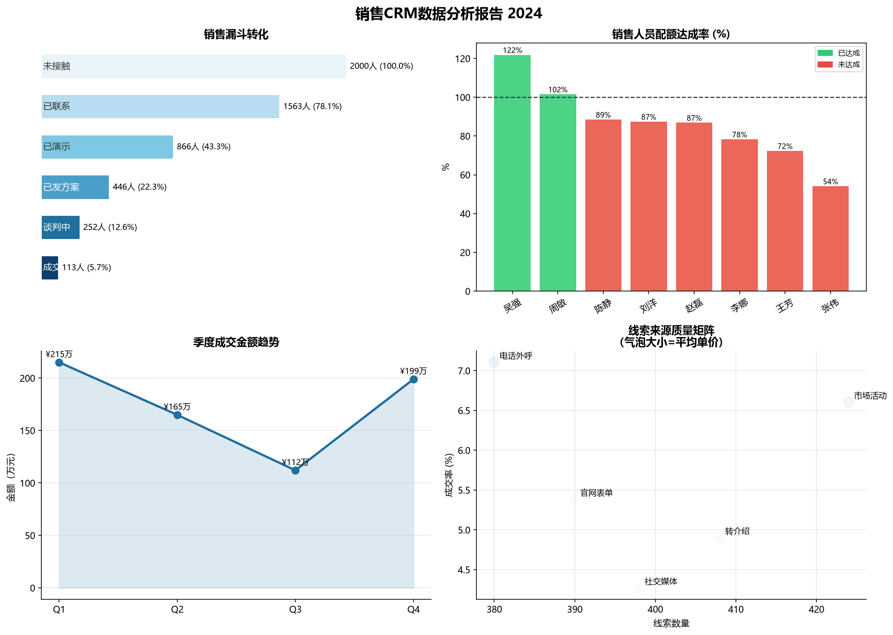

# 销售漏斗分析系统

基于 CRM 销售数据，构建完整的漏斗转化分析、销售人员达成率追踪和线索来源归因分析系统。

## 业务背景

在销售 CRM 实习中发现，团队依赖 Excel 手工追踪销售进展，无法快速定位转化瓶颈和高价值线索来源。本项目用 Python 对 2000 条线索数据进行系统性分析，输出可落地的销售策略建议。

## 核心分析模块

### 1. 漏斗转化分析
- 计算各阶段转化率，精准定位最大流失节点
- 结论：**已联系 → 已演示** 转化率仅 55.4%，是最大流失节点，建议优化邀约话术

### 2. 销售人员达成率
- 对比各销售的成交率、成交金额与年度配额完成情况
- 识别出配额达成率低于 60% 的销售，制定针对性辅导计划

### 3. 线索来源归因
- 对比 5 种线索来源的成交率与平均单价
- 结论：电话外呼成交率最高（7.1%），转介绍均单最高（¥7.3万），资源应向这两个渠道倾斜

### 4. 季度趋势分析
- 监控季度成交量和金额变化，识别 Q3 低谷原因

## 技术栈

| 工具 | 用途 |
|------|------|
| Python 3.11 | 数据处理主语言 |
| Pandas | 数据清洗与聚合 |
| Matplotlib / Seaborn | 可视化 |
| NumPy | 统计计算 |

## 项目结构

```
sales_funnel_analysis/
├── generate_data.py      # 模拟 CRM 数据生成
├── analysis.py           # 核心分析脚本
├── data/
│   └── crm_leads.csv     # 2000 条线索数据
└── output/
    └── sales_analysis_report.png  # 分析报告图表
```

## 快速运行

```bash
pip install pandas numpy matplotlib seaborn
python generate_data.py   # 生成数据
python analysis.py        # 运行分析，图表输出到 output/
```

## 分析结果



## 关键结论与建议

| 问题 | 数据依据 | 建议 |
|------|---------|------|
| 演示邀约转化率低 | 已联系→已演示仅55.4% | 优化邀约话术，降低演示门槛 |
| 转介绍资源利用不足 | 均单¥7.3万最高但线索量居中 | 建立客户转介绍激励机制 |
| 个别销售成交率偏低 | 张伟成交率3.6%，团队均值5.7% | 针对性话术培训和陪访辅导 |
